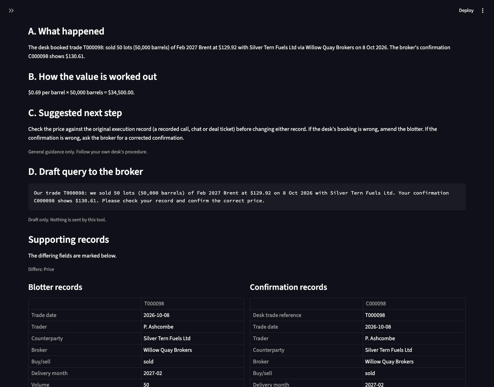

# Brent Trade Reconciliation Tool

A demonstration tool for comparing a desk's trade blotter with broker confirmations before settlement. It finds disagreements for review; it does not amend trades, contact brokers or settle anything. **All supplied trades, people and firms are fictional.**

**Built by Henry Cast** · **Live demo:** https://brent-trade-reconciliation.streamlit.app

**Prices are simulated, anchored to published Brent spot prices.**[1]



## Measured results: November 13, 2026

Retained expiry-corrected evaluation only; each seeded dataset has 200 desk trades and 202 confirmations.

- Development seeds 1–5: **160 positive cases found**, 75 harmless cases correctly quiet; zero missed cases, false alarms or wrong labels.
- Reserved seeds 6–20: **480 positive cases found**, 225 harmless cases correctly quiet; zero missed cases, false alarms or wrong labels. Combined: **640 found**, 300 correctly quiet across 20 datasets.
- Every seeded dataset: **32 of 32** positive cases found and **15** correctly quiet. The separate clean control: **200 established pairs and no exceptions**; precision and recall are undefined because it has no labelled positives.

Positive cases include two ambiguous review groups per dataset: found does not mean resolved. Detailed tables remain in `evidence/latest/`.

> Correct against its specification on generated data with known answers. Not evidence of production readiness.

## Try it

- **See an example (200 trades)** opens a fictional dataset with planted disagreements and harmless differences. Its known answers support a **Scorecard**.
- **Try a small sample with three breaks** runs the supplied ten-trade sample directly: one price difference, one buy/sell mismatch and one missing confirmation. This direct sample has no scorecard.
- **Upload your own files** accepts a blotter and confirmations. Uploads have no known-answer scorecard, including supplied sample files.

**Change dataset** stays collapsed until you open it. Use development seeds 1–5 when experimenting.

## Read the results

A break can be a different price, quantity, buy/sell direction or delivery month, a missing confirmation or a duplicate. Start with the high-priority items, then select an exception to read A–D: what happened, the value calculation, a suggested next step and a draft broker query. The original records are supporting detail below. Nothing is sent.

Distinct matched trades and established pairs are different counts: duplicates can increase pairs without adding trades. Ambiguous groups retain all candidates for review, not an invented pairing. Review values are blank, not zero, and excluded from totals.

The total value of discrepancy is mostly full-notional items, **not a loss or P&L**, actual economic damage or money owed. See [Reading results](docs/READING_RESULTS.md) for the six matching rules, unchanged A–D explanations, CSV details and valuation breakdown.

## Limitations

- All supplied and measured trades are generated; this tool has not been validated on real desk blotters or broker confirmations. Uploads are not independent known-answer tests.
- Spot prices are not futures prices. Across the same 22 October 2026 dates, EIA spot averaged $123.93/bbl versus $104.73/bbl in ICE’s public historical chart for the fixed January 2027 Brent contract: a monthly-mean gap of $19.20/bbl, roughly $20 higher.[2], [3] This fixed-contract, date-matched chart comparison is neither verified official settlements nor a rolling front-month series; it does not imply a $20 gap every day. This tool adds simulated month adjustments and noise to each date's EIA spot observation, without calibration to ICE futures.
- The same AI coding agent wrote both this tool's fictional-data creation and reconciliation code; shared assumptions and mistakes can overlap. Separate scoring and stage reviews reduce some risks but do not make this benchmark independent real-world evidence.
- Reserved seeds 6–20 were seen earlier, not an unseen benchmark. More seeds from this constrained source do not establish real-data generalisation.
- Records have dates, not times. This tool assumes expiry-day trades precede the cutoff; it cannot establish intraday order, timing or real pre-expiry eligibility. Expiry uses a bounded local calendar, not a live holiday service; unsupported dates fail clearly.
- Suggested actions are general demonstration guidance, not your firm's procedure. Check originals and follow your desk's procedure; copying a draft does not establish which record is correct.
- Scope: Brent, USD, lots/barrels, specified tolerances and manually maintained aliases. Fees, commissions, other products, tonnes and unspecified economic disagreements are outside the rules; unsupported cases may error rather than receive invented classifications or values.
- There is no account system, production security assessment, live feed or settlement connection. Do not upload confidential desk data to an unassessed host.

## Authorship and local use

Henry Cast specified, directed and tested this tool; the code was written with an AI coding agent, and each stage was independently reviewed before the next began.

Stage reviews are not production certification. This tool uses deterministic Python and exact decimal arithmetic, not AI/LLM calls; explanations use fixed templates.

Use Python 3.14. Only macOS has been tested locally; Linux and Windows have not been separately validated. From the project folder on macOS/Linux:

```bash
python3.14 -m venv .venv
source .venv/bin/activate
python -m pip install -r requirements.txt
streamlit run app.py
```

Windows needs its own virtual-environment activation command. Open Streamlit's printed local address; stop with Ctrl+C. No API key, custom startup script, workbook or price download is needed. [Reading results](docs/READING_RESULTS.md#local-checks-and-session-files) includes test commands.

Private per-session workspaces in ignored `.app_sessions/` are ephemeral, not durable storage; sessions may disappear when the process or host stops.

## Data credit and licence

Included: **22 daily EIA Brent spot prices for October 2026**, in USD per barrel, stored in `data/brent_spot.csv`.

Source: U.S. Energy Information Administration (Nov 2026).[1]

EIA credits Refinitiv as the underlying spot-price source.[4]

The expiry calendar cites ICE's contract specification and expiry listing.[5], [6] Calendar facts do not make simulated prices observed futures settlements.

The project's own code uses the **MIT licence** in `LICENSE`. Copyright (c) 2026 Henry Cast. Third-party data and references retain their applicable terms; they are not relicensed as MIT.

[1]: https://www.eia.gov/dnav/pet/hist/RBRTEd.htm
[2]: https://www.eia.gov/dnav/pet/hist/LeafHandler.ashx?n=PET&s=RBRTE&f=M
[3]: https://www.ice.com/products/219/Brent-Crude-Futures/data
[4]: https://www.eia.gov/dnav/pet/pet_pri_spt_s1_d.htm
[5]: https://www.ice.com/products/219/Brent-Crude-Futures
[6]: https://www.ice.com/products/219/Brent-Crude-Futures/expiry
